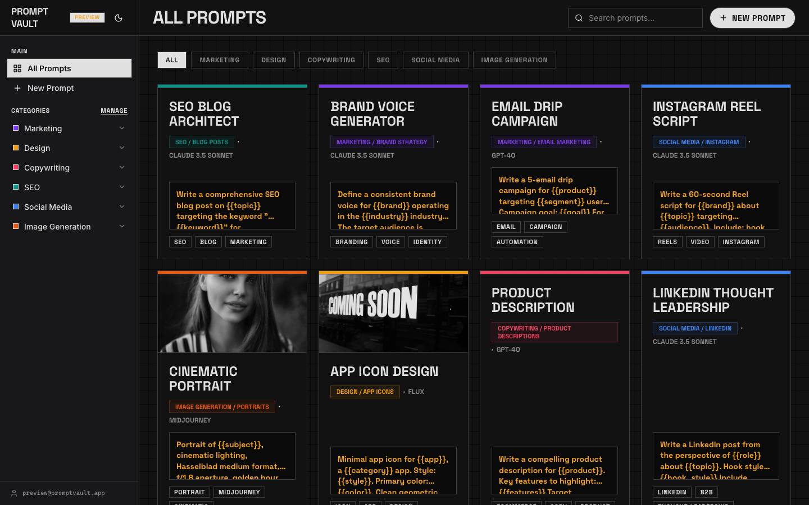
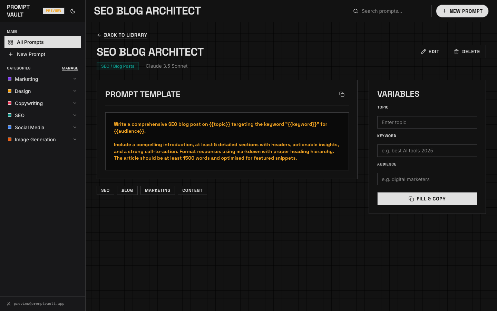
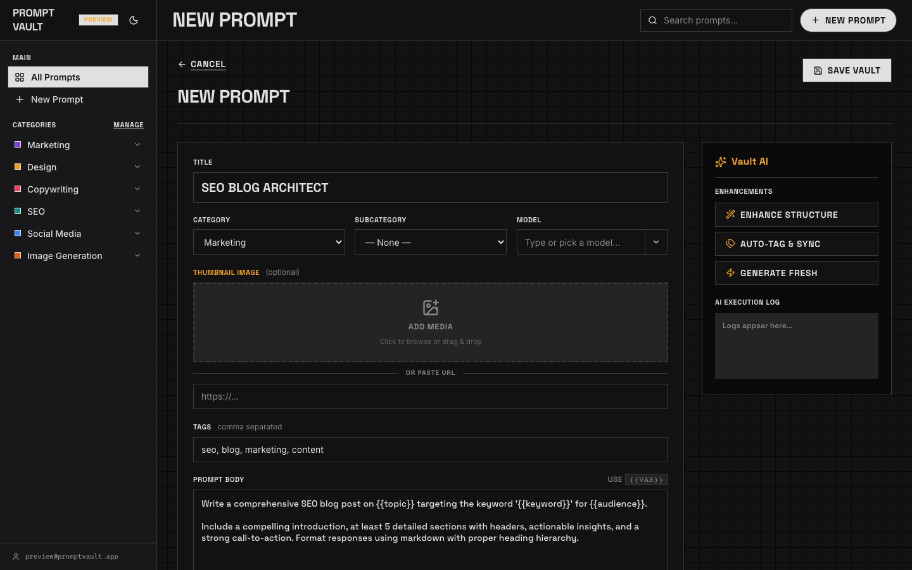
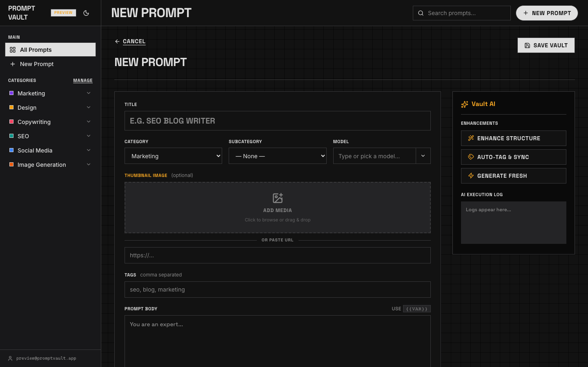
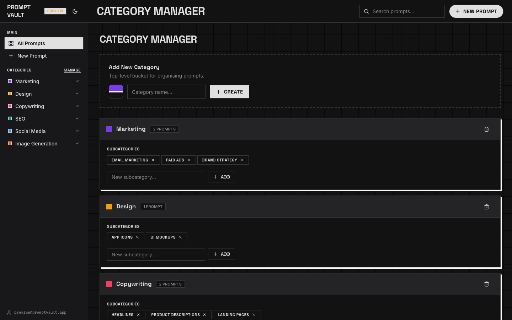
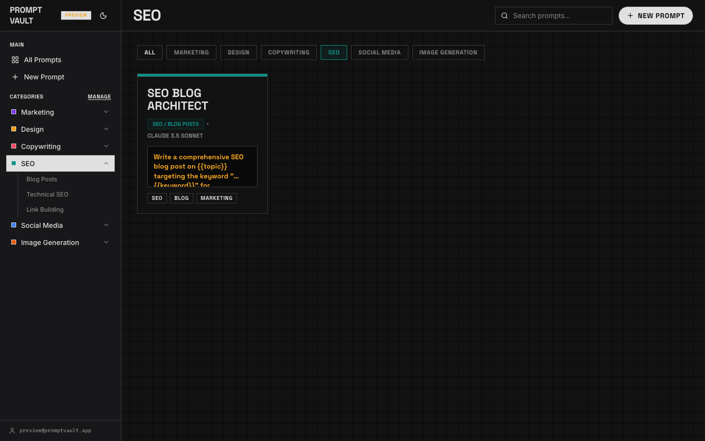

# Prompt Vault 🗄️

> A beautiful, multi-user AI prompt library built entirely on Google Apps Script, Google Sheets, and Google Drive — no servers, no hosting fees, no databases.

[](https://opensource.org/licenses/MIT)
[](https://script.google.com)
[](https://developer.mozilla.org/en-US/docs/Web/JavaScript)

---


---

## What is Prompt Vault?

**Prompt Vault** is a team prompt library that helps AI power users store, organise, and reuse their best prompts across tools like ChatGPT, Claude, Gemini, Midjourney, and more.

Instead of losing prompts in chat histories or scattered notes, Prompt Vault gives your team a single, searchable, categorised library — with role-based access, image attachments, variable substitution, and AI-assisted prompt enhancement.

**The entire backend runs on your existing Google Workspace.** Your data lives in a Google Spreadsheet you own. No monthly SaaS fee. No vendor lock-in.

---

## ✨ Features

| Feature | Description |
|---------|-------------|
| 📁 **Category System** | Organise prompts into categories with colour codes and subcategories |
| 🔍 **Full-text Search** | Filter prompts by title, tags, body, or category in real time |
| 🖼️ **Image Attachments** | Attach reference images (vision prompts, style references) via Google Drive |
| 🔡 **Variable Substitution** | Use `{{variable}}` syntax — fill & copy with one tap |
| 🤖 **AI Assist** | Enhance, auto-tag, or generate prompts using Claude / Gemini |
| 🗂️ **Archive System** | Deleted category prompts are safely archived & restoreable |
| 👥 **Multi-user Auth** | Whitelist emails via Script Properties — each user sees only their prompts |
| 🌙 **Dark / Light Mode** | Brutalist-inspired UI with full theme switching |
| 📱 **Mobile Friendly** | Responsive layout, custom modals (no native `confirm()` dialogs) |
| 🆓 **Zero Cost** | Runs on Google Apps Script — free for all Google accounts |

---

## 📸 Screenshots


*Your prompt library — filter by category, search by keyword*


*View a prompt with variables ready to fill and copy*


*Create a new prompt with title, category, tags and `{{variable}}` placeholders*


*AI-powered enhancements right inside the editor*


*Organise prompts into colour-coded categories and subcategories*


*Filter library by category — SEO prompts shown here*

---

## 🎬 Intro Video


*26-second walkthrough: library, add prompts, manage categories*

**Full HD version:** [prompt-vault-intro.mp4](prompt-vault-intro.mp4)

---

## 🛠️ Tech Stack

| Layer | Technology |
|-------|-----------|
| **Runtime** | Google Apps Script (V8) |
| **Database** | Google Sheets (one tab per category) |
| **File Storage** | Google Drive |
| **Frontend** | HTML5 + Vanilla JS + Vanilla CSS |
| **Icons** | [Lucide Icons](https://lucide.dev) (CDN) |
| **Fonts** | Google Fonts — Inter + Space Grotesk |
| **AI** | Anthropic Claude API (configurable) |

---

## 🚀 Setup Guide

### Prerequisites

- A Google account (free)
- A Google Spreadsheet (create a new blank one)
- *(Optional)* An Anthropic API key for AI features

### Step 1 — Create the Apps Script Project

1. Go to [script.google.com](https://script.google.com) → **New Project**
2. Rename the project to `Prompt Vault`

### Step 2 — Copy the Source Files

Copy each file from the `src/` folder into your Apps Script project:

| File | Type | Purpose |
|------|------|---------|
| `Code.gs` | Script | Entry point, auth, config reader |
| `Sheets.gs` | Script | All CRUD operations on Google Sheets |
| `Drive.gs` | Script | Image upload to Google Drive |
| `AI.gs` | Script | Claude AI integration |
| `Setup.gs` | Script | One-time spreadsheet setup |
| `Index.html` | HTML | App shell / layout |
| `_Styles.html` | HTML | All CSS styles |
| `_Scripts.html` | HTML | All frontend JavaScript |

> In the Apps Script editor: use **File → New → Script file** for `.gs` files and **File → New → HTML file** for `.html` files.

### Step 3 — Configure Script Properties

In the Apps Script editor: **Project Settings → Script Properties → Add property**

| Property | Value | Required |
|----------|-------|----------|
| `SPREADSHEET_ID` | Your Google Sheet ID (from the URL) | ✅ |
| `ALLOWED_EMAILS` | Comma-separated list of allowed emails | Optional |
| `ANTHROPIC_API_KEY` | Your Claude API key | Optional |
| `DRIVE_FOLDER_ID` | Google Drive folder ID for image uploads | Optional |

**Finding your Spreadsheet ID:**
The ID is the long string in your sheet URL:
```
https://docs.google.com/spreadsheets/d/YOUR_SPREADSHEET_ID_HERE/edit
```

### Step 4 — Run Initial Setup

In the Apps Script editor:
1. Select the `setupPromptVault` function from the dropdown
2. Click **Run** — this creates the required sheets and schema

### Step 5 — Deploy as Web App

1. Click **Deploy → New Deployment**
2. Select type: **Web App**
3. Set **Execute as**: Me
4. Set **Who has access**: Anyone with Google Account *(or "Only myself" for private use)*
5. Click **Deploy** → **Authorise**
6. Copy the **Web App URL** — this is your app link!

---

## 📂 Project Structure

```
prompt-vault/
├── src/
│   ├── Code.gs          # Web app entry point & auth
│   ├── Sheets.gs        # CRUD: prompts, categories, archive
│   ├── Drive.gs         # Image upload & URL generation
│   ├── AI.gs            # AI prompt enhancement via Claude
│   ├── Setup.gs         # One-time spreadsheet initialisation
│   ├── Index.html       # App HTML shell
│   ├── _Styles.html     # CSS design system
│   └── _Scripts.html    # Frontend JS (SPA logic)
├── README.md
├── LICENSE
├── CONTRIBUTING.md
└── .gitignore
```

---

## 🗄️ Data Architecture

Prompt Vault uses a **Google Sheet as a relational database**:

| Sheet Tab | Purpose |
|-----------|---------|
| `Config` | Category definitions, colours, subcategories, app settings |
| `_Index` | Fast lookup index of all prompts across categories |
| `_Archive` | Soft-deleted prompts from removed categories |
| `[CategoryName]` | One sheet per category containing full prompt data |

Each prompt stores: `PromptID`, `Title`, `Subcategory`, `Tags`, `Prompt`, `Variables` (JSON), `Model`, `ImageURL`, `ImprovementNotes`, `CreatedBy`, `CreatedAt`, `ModifiedAt`.

---

## 🔐 Security & Multi-User

- Emails are validated server-side in `Code.gs` using `Session.getActiveUser().getEmail()`
- Prompts are filtered per-user — users only see their own prompts
- The app is deployed "Execute as: Me" so your Sheets credentials are never exposed

> **Note:** For a team deployment, add all team email addresses to the `ALLOWED_EMAILS` Script Property.

---

## 🤝 Contributing

Contributions are welcome! See [CONTRIBUTING.md](CONTRIBUTING.md) for guidelines.

**Ideas for contributions:**
- 🔔 Export to Markdown / JSON
- 🏷️ Bulk tag editor
- 📊 Usage analytics dashboard
- 🔗 Public prompt sharing links
- 🌐 Support for OpenAI / Gemini in AI Assist

---

## 📄 License

MIT © [Your Name] — see [LICENSE](LICENSE) for details.

---

## 🙏 Acknowledgements

- [Lucide Icons](https://lucide.dev) for beautiful open-source icons
- [Google Apps Script](https://developers.google.com/apps-script) for making serverless apps accessible to everyone
- [Anthropic](https://anthropic.com) for the Claude API powering AI Assist
